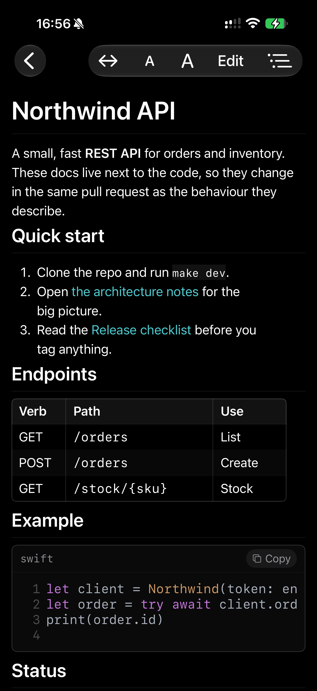
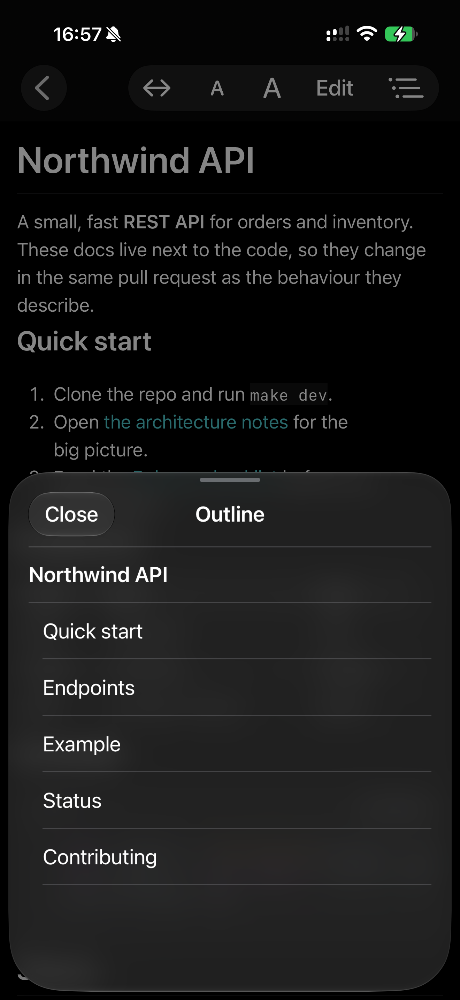
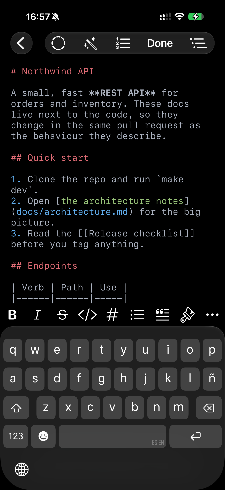

# Vera

A native git-aware file editor for iOS and macOS. Part of the Mira ecosystem.

**Zero configuration.** No vaults, no projects. Vera is a transparent window into your iCloud Drive — it shows every file you already have — and, opt-in, every file in your **GitHub repositories**. Any file Vera can open — Markdown, code, JSON/YAML, plain text — is editable, not just read-only.

**Open source.** The full source is public on GitHub — see the [repository](https://github.com/mabaeyens/vera-apps) to browse the code or verify the [privacy policy](PRIVACY.md).

See [CHANGELOG.md](CHANGELOG.md) for recent changes.

## Download

- **macOS** — grab the latest notarized `.dmg` from the [Releases page](https://github.com/mabaeyens/vera-apps/releases/latest). It's Developer ID-signed and notarized, so it opens without Gatekeeper warnings — no App Store needed.
- **iOS / iPadOS**: [Vera on the App Store](https://apps.apple.com/app/id6768027447). Free, no account. A public [TestFlight beta](https://testflight.apple.com/join/AyS6RfM8) is also available.

## Screenshots

<p>



</p>

## Features

- **Browse** — recursive file tree of every file Vera can open in your chosen folder (iCloud or local) — Markdown, code (Swift, Python, Go, Rust, shell, SQL, TypeScript/TSX, JavaScript/CJS, and more), JSON/YAML, plain text, images; the local folder and each GitHub repo collapse via the same leading-chevron disclosure; lazy per-folder expansion; curated per-language icons, Markdown files carry the Markdown mark
- **GitHub (opt-in)** — connect a repo with a fine-grained token; browse its full file tree in the sidebar, open files in tabs alongside your local files, create new ones, edit with the full editor, then **commit** straight to the branch or **open a pull request**; **What Changed** shows a native diff (and recent commit history) when a file moved on. The token stays in your device Keychain; the list of connected repos syncs via iCloud. GitHub.com only — GitHub Enterprise Server isn't supported. Pull down the sidebar on iOS/iPadOS to refresh local files and every connected repo
- **Read** — native `PreviewTextView` (UITextView/NSTextView) with full cross-block selection and rich-text copy; syntax-highlighted fenced code blocks and code files (atom-one theme via Highlightr); structured table rendering; selectable text copies rich text to clipboard; pinch-to-zoom on images (mouse/trackpad zoom controls on macOS)
- **Edit**: every supported file type is editable, not just Markdown: syntax-highlighted editor with an adjustable font size; the Edit button (or ⇧⌘P) switches modes; new empty files open directly in edit mode; the Markdown-specific formatting bar (undo/redo, bold, italic, heading, Atlas, more) shows only for `.md` files, code and other text files stay a clean syntax-highlighted editor with no risk of inserting stray formatting characters
- **Open files**: there is no tab bar: open documents live in the sidebar's "Open Files" section, with the same close controls on every platform; an open document keeps its editor, scroll position and mode when you switch away and back
- **Go to File**: a fuzzy file switcher over the open folder (⌘P with a keyboard, "Go to File…" in the ••• menu on a phone)
- **Outline**: a sheet of the document's headings with a jump to any of them, in both Preview and Edit
- **Links**: relative links, links to a section (`other.md#second-part`) and `[[wikilinks]]` open the target in the app; a link into a long document scrolls to the section. Links that point outside the opened folder are never followed
- **Rename**: rename a file from the sidebar context menu; open documents, pinned and recent entries follow it, and a rename never overwrites an existing file
- **Lists**: bullet, numbered, task and quote lists continue on Return and an empty item ends the list; Tab and Shift-Tab indent and outdent list lines; code fences are left alone
- **Search**: search the whole open folder from the sidebar (filenames and content, streaming results, skips `node_modules`, `.git` and anything in `.gitignore`); ⌘F finds and replaces inside a document
- **Safe saving**: if a file changes on disk while it is open (a `git pull`, another editor, iCloud), autosave will not overwrite it; the notice offers Reload or Overwrite
- **Font size** — adjustable editor font size per-session, applies to Markdown prose, tables, and syntax-highlighted code alike
- **Atlas** — tap-to-insert Markdown syntax snippets; accessible from the toolbar in both preview and edit mode for Markdown files
- **Linter** — real-time Markdown syntax warnings while editing (debounced, off main thread); toggle in Settings; **Auto-fix** button repairs heading spacing, collapses blank lines, strips trailing whitespace, replaces smart quotes and dashes
- **Remove Formatting** — strip Markdown from selected text via the context menu
- **Focus Mode**: distraction-free writing: hides the formatting bar and linter (and on Mac the sidebar too)
- **Icon Guide** — a reference of every icon in the app, opened from the ••• overflow menu on iPhone, iPad and Mac
- **New file** — create a Markdown, text, JSON, or YAML file in any folder directly from the sidebar; any existing file of any supported type opens straight into the editor
- **Open file** — open any file directly without selecting a folder first; works from the sidebar or Finder (macOS)
- **Reset** — "Reset Vera" clears folder selection without deleting files; accessible from the About sheet
- **Offline** — edits and new files work without a connection; iCloud syncs on reconnect
- **Dark / light** — adaptive; follows system appearance
- **macOS sidebar** — persistent; only the toolbar button can hide it (never auto-collapses)

## Identity

| Field | Value |
|-------|-------|
| Bundle ID | `com.mab.Vera` |
| GitHub | `git@github.com:mabaeyens/vera-apps.git` |
| Swift | 6, Xcode 26+ |
| Minimum iOS | 26.4 |
| Minimum macOS | 26.4 |

For architecture, source layout, and technical decisions see [PROJECT.md](PROJECT.md).

## Testing

There is a UI test suite in `Vera/VeraUITests`. It runs on a simulator or a physical device against a throwaway fixture folder that a debug build seeds inside its own sandbox (`-VeraUITestSeed YES`), so it needs no access to your files:

```bash
SIM=<simulator-udid> bash scripts/ui-tests.sh                  # whole suite on a simulator
DEVICE=<device-udid> TESTS="FeatureUITests" bash scripts/ui-tests.sh   # one class on a device
```

`StoreScreenshotTests` regenerates the App Store screenshots from a sample docs repo (`-VeraUITestStore`); the current set is in `AppStore/screenshots`.

## License

[MIT](LICENSE) © Miguel A. Baeyens. Free forever, no account, nothing sent anywhere.

Built with [Claude Code](https://claude.com/claude-code).
